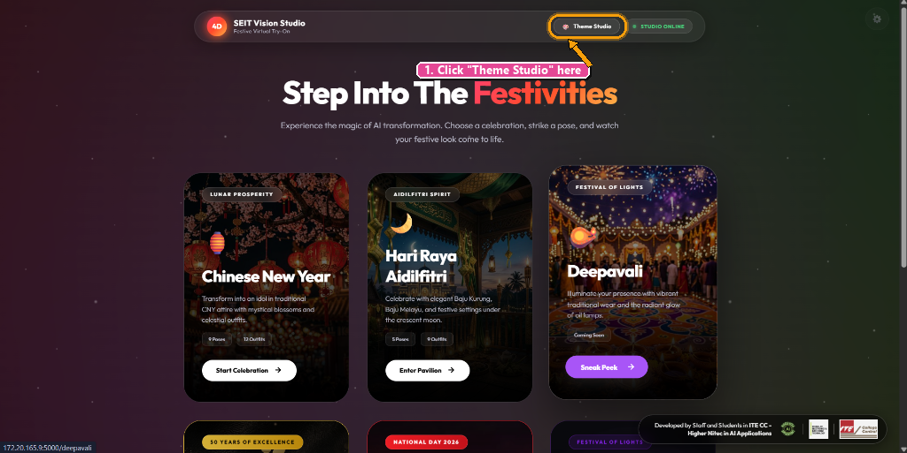
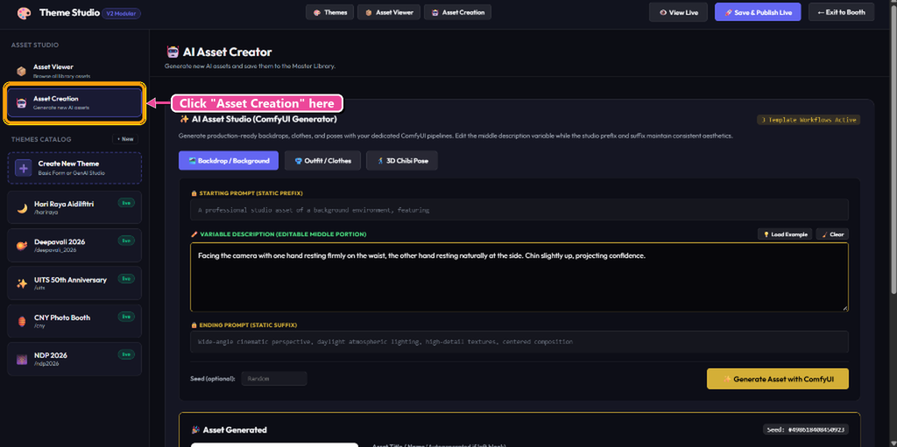
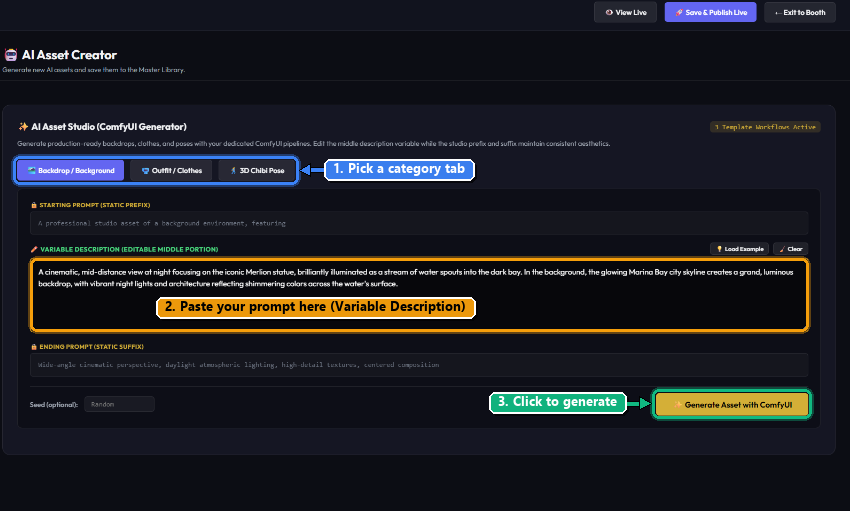
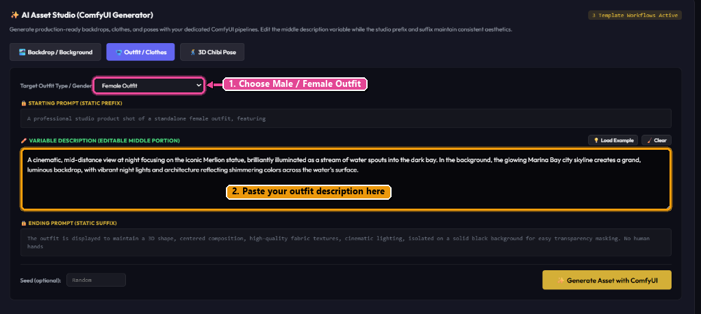
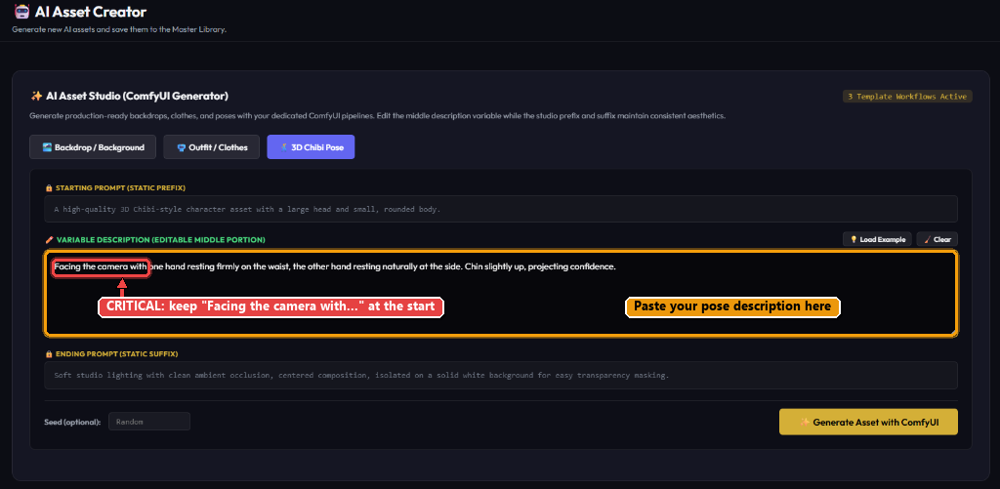
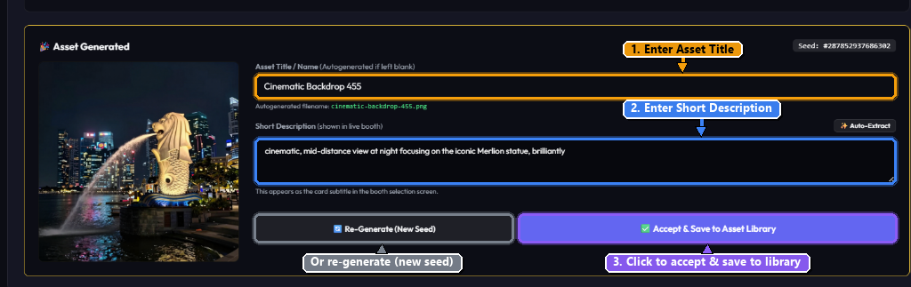
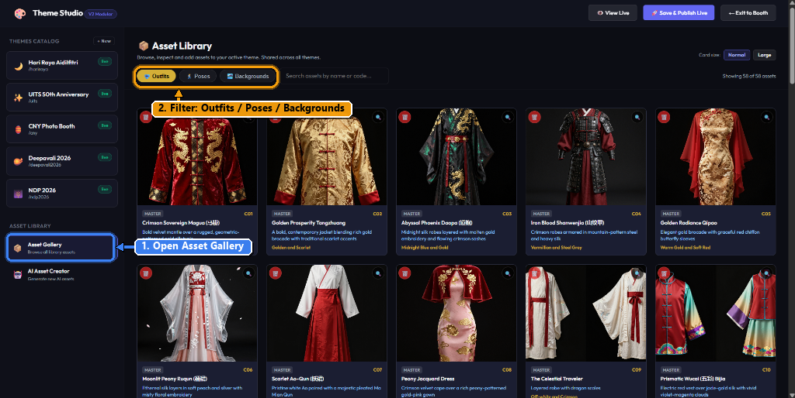
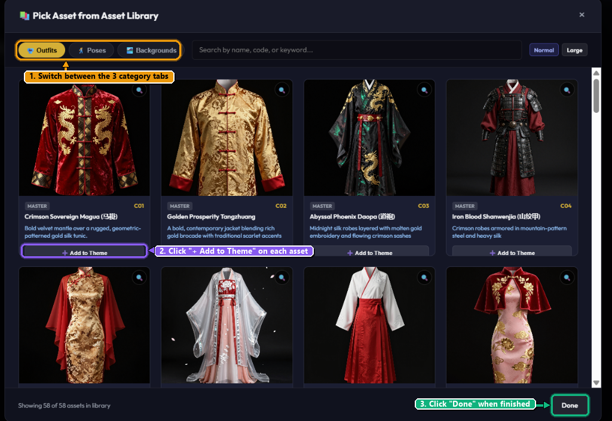

# SEIT Vision Studio: Complete End-to-End Asset Creation & Publishing Guide

This tutorial provides an exact, step-by-step walkthrough on how to generate AI assets using **ChatGPT** and **ComfyUI**, organize them in the **Master Asset Gallery**, link them to celebration themes (such as **Deepavali 2026**), and publish the live virtual try-on kiosk.

---

## 🎯 Complete Workflow Overview

```
┌─────────────────────────────────────────────────────────────────────────────┐
│ PHASE 1: GENERATE ASSETS                                                    │
│ [Landing Page] ➔ "Theme Studio" ➔ "AI Asset Creator" ➔ Select Category      │
│ ➔ Prompt ChatGPT (Recipe) ➔ ComfyUI Render ➔ Accept & Save to Library       │
└──────────────────────────────────────┬──────────────────────────────────────┘
                                       │
┌──────────────────────────────────────▼──────────────────────────────────────┐
│ PHASE 2: LINK TO THEME & PUBLISH                                            │
│ Select Theme (e.g. Deepavali) ➔ "Asset Manager" Tab ➔ Pick from Library     │
│ ➔ Add Outfits, Poses & Backdrops ➔ "Save & Publish Live" ➔ "View Live"      │
└─────────────────────────────────────────────────────────────────────────────┘
```

---

## Step 1: Access Theme Studio from Landing Page

When you first load **SEIT Vision Studio**, you are on the public home page featuring live festive celebration cards (Chinese New Year, Hari Raya Aidilfitri, Deepavali, etc.).

1. Look at the top navigation bar next to the green `STUDIO ONLINE` indicator.
2. Click the pill button labeled **Theme Studio** (with the artist palette icon).



---

## Step 2: Open "Asset Creation" in the Sidebar

Once inside Theme Studio, you can configure theme aesthetics and workflows. To create new visual assets:

1. Look at the **left sidebar**.
2. Under the **ASSET STUDIO** section at the top of the sidebar, find **Asset Creation**.
3. Click on **Asset Creation** (robot icon 🤖) to open the **AI Asset Creator** workspace.



---

## Step 3: Choose Asset Category & Understand Prompt Architecture

The **AI Asset Studio** uses a 3-part "Sandwich Prompt" architecture so you never have to configure ComfyUI nodes manually:
* 🔒 **STARTING PROMPT (STATIC PREFIX)**: Locked studio parameters ensuring framing, lighting, and camera angle.
* ✏️ **VARIABLE DESCRIPTION (EDITABLE MIDDLE PORTION)**: **The only field you edit!** Paste your ChatGPT visual description here.
* 🔒 **ENDING PROMPT (STATIC SUFFIX)**: Locked technical keywords ensuring background transparency and high fabric/surface detail.

### The 3 Asset Categories:

#### 1. Backdrop / Background
For scenic festive locations (e.g., illuminated Singapore Merlion, Deepavali festival streets).
* Click the **Backdrop / Background** tab.
* Click **Load Example** to inspect prompt structure.



---

#### 2. Outfit / Clothes (Gender Selection)
For standalone traditional costumes isolated on black background for try-on masking.
* Click the **Outfit / Clothes** tab.
* > [!IMPORTANT]
  > **Select Gender via Dropdown:**  
  > Use the dropdown labeled **Target Outfit Type / Gender** to toggle between **Male Outfit** and **Female Outfit**. This dynamically modifies the ComfyUI prefix to match the corresponding garment cut.



---

#### 3. 3D Chibi Pose (Critical Framing Constraint)
For creating 3D avatar pose postures on a clean white background.
* Click the **3D Chibi Pose** tab.
* > [!CAUTION]
  > **CRITICAL RULE — Never cut off "Facing the camera with":**  
  > When prompting ChatGPT or any Gen AI, **you must explicitly instruct it never to remove or alter `"Facing the camera with..."`**. The platform's try-on alignment strictly depends on this opening to ensure characters look directly at the kiosk camera!



---

## Step 4: Prompting ChatGPT / Gen AI

Open **ChatGPT** (or Gemini / Claude). Always request three specific outputs:
1. **Asset Title** (catchy 2-4 words)
2. **Short Description** (1 sentence summary for kiosk selection card)
3. **Variable Description** (the visual prompt description)

### Ready-to-Use Prompt Templates:

#### Template A: Backdrop (Creative Prompt Designer - Deepavali Locations)
```text
Act as a creative prompt designer. Generate [number] descriptive prompts for Deepavali (Diwali) festival locations, inspired by the following sample format and add a bit of people:

Sample Reference:
"A cinematic, mid-distance view at night focusing on the iconic Merlion statue, brilliantly illuminated as a stream of water spouts into the dark bay. In the background, the glowing Marina Bay city skyline creates a grand, luminous backdrop, with vibrant night lights and architecture reflecting shimmering colors across the water's surface."

Requirements:
1. Subject & Theme: Focus strictly on iconic festive locations, streetscapes, architecture, light installations, or sacred outdoor/indoor spaces decorated for Deepavali.
2. People & Atmosphere: Include a bit of people in the background (such as soft-focus festival celebrants, distant silhouettes enjoying the lights, or families admiring rangoli) to add lively cultural warmth, scale, and ambiance, while keeping the main central foreground open for the photo booth subject. (Note: If you prefer empty streetscapes, specify 'No People').
3. Format per item:
   - A bolded, evocative Title.
   - Prompt: A detailed, sensory-rich paragraph specifying camera angle/framing (e.g., wide shot, low-angle, vanishing perspective), lighting conditions (dusk, night, warm amber uplighting, micro-LED glow), key cultural decor (diyas, rangoli, arches, marigolds), and environmental atmosphere (festive streets, damp pavements, incense haze, soft distant crowd).
   - Description: A concise 1-sentence summary highlighting the core mood, setting, and visual appeal.
4. Output: Text prompts only (do not generate actual images).
```

#### Template B: Outfit (Male or Female Festive Wear)
```text
help me generate a detailed festive outfit prompt for Deepavali traditional wear (female or male).

Requirements:
- Describe the garment details (embroidery, fabric textures, colors, drape, traditional festive ornaments).
- Keep it focused only on the standalone outfit garment.

Please provide:
1. Asset Title (e.g. "Royal Maroon Silk Sherwani" or "Golden Zari Silk Saree")
2. Short Description (1 concise sentence)
3. Variable Description (the detailed description of the outfit to be generated)
```

#### Template C: 3D Chibi Pose (Camera-Facing Constraint)
```text
help me generate a 3D chibi avatar pose for our photo booth studio.

IMPORTANT CONSTRAINT: You MUST explicitly start the pose description with:
"Facing the camera with [pose details]"
Do NOT cut off or remove "Facing the camera with", because the kiosk try-on system strictly requires front-facing alignment.

Here is the example reference:
"Facing the camera with one hand resting firmly on the waist, the other hand resting naturally at the side. Chin slightly up, projecting confidence."

Please provide:
1. Asset Title (e.g. "Confident Waist Pose" or "Festive Namaste Greeting")
2. Short Description (1 sentence describing the posture)
3. Variable Description (starting strictly with "Facing the camera with...")
```

---

## Step 5: Generate with ComfyUI, Review & Accept

1. Return to **SEIT Vision Studio** ➔ **AI Asset Creator**.
2. Select your category tab (**Backdrop**, **Outfit**, or **3D Chibi Pose**).
3. If generating an outfit, verify the **Target Outfit Type / Gender** dropdown.
4. Paste your prompt into **VARIABLE DESCRIPTION (EDITABLE MIDDLE PORTION)**.
5. Click **✨ Generate Asset with ComfyUI** and wait a few seconds for the render.
6. In the **Asset Generated** review screen:
   * Enter your **Asset Title / Name** (e.g. *Cinematic Backdrop 455*).
   * Enter the **Short Description** (or click **✨ Auto-Extract**).
7. Review your asset:
   * **Happy with it?** Click the purple **✅ Accept & Save to Asset Library** button.
   * **Want a different variation?** Click **🔄 Re-Generate (New Seed)**.



---

## Step 6: Inspect Your Items in the Asset Gallery

Once accepted, all assets are permanently saved into the centralized **Master Library**:

1. In the left sidebar under **ASSET LIBRARY**, click **Asset Gallery**.
2. Switch between **Outfits**, **Poses**, and **Backgrounds** to see all items.
3. Assets here are globally accessible to all themes across the studio!



---

## Step 7: Add Assets to Your Theme (e.g., Deepavali)

To make your newly generated assets available in a specific festive photo booth:

1. In the left sidebar under **THEMES CATALOG**, click on your desired theme (e.g., **Deepavali 2026**).
2. In the top horizontal navigation tabs, click on **Asset Manager**.
3. Click the button **"Pick from Asset Gallery"** (or *Pick Asset from Asset Library*).
4. In the modal popup:
   * Switch between **Outfits**, **Poses**, and **Backgrounds**.
   * Click **+ Add to Theme** on each newly created item you want in this theme.
5. Click **Done** at the bottom right of the modal to close it.



---

## Step 8: Save & Publish Live, Then View Live

1. In the top right header bar of Theme Studio, click **🚀 Save & Publish Live**. This commits the configuration and pushes your new backdrops, clothes, and poses to the kiosk.
2. Click **👁️ View Live** right beside it to test your live virtual try-on booth in real-time!

---

## 📋 The 60-Second Complete Checklist

- [ ] **Step 1:** Clicked **Theme Studio** from Landing Page top nav.
- [ ] **Step 2:** Clicked **AI Asset Creator** in the left sidebar.
- [ ] **Step 3:** Selected target asset category (*Backdrop*, *Outfit*, or *3D Chibi Pose*).
- [ ] **Step 4:** If Outfit: set **Target Outfit Type / Gender** (Male / Female).
- [ ] **Step 5:** If Pose: ensured ChatGPT kept **"Facing the camera with..."** as opening.
- [ ] **Step 6:** Prompted ChatGPT for: Description, Title, and Short Summary.
- [ ] **Step 7:** Pasted into **Variable Description** & clicked **✨ Generate Asset with ComfyUI**.
- [ ] **Step 8:** Filled Title & Short Description, then clicked **✅ Accept & Save to Asset Library**.
- [ ] **Step 9:** Selected target theme (e.g. **Deepavali 2026**) in left sidebar.
- [ ] **Step 10:** Clicked **Asset Manager** tab ➔ **Pick from Asset Gallery**.
- [ ] **Step 11:** Switched through tabs and clicked **+ Add to Theme** on assets, then clicked **Done**.
- [ ] **Step 12:** Clicked **🚀 Save & Publish Live**, then **👁️ View Live** to test live booth!
