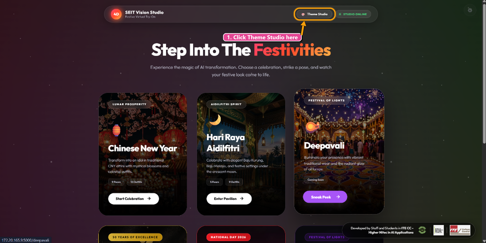
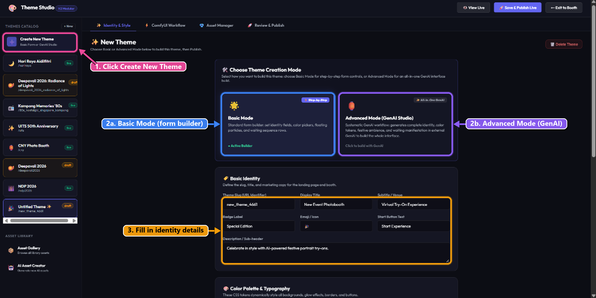
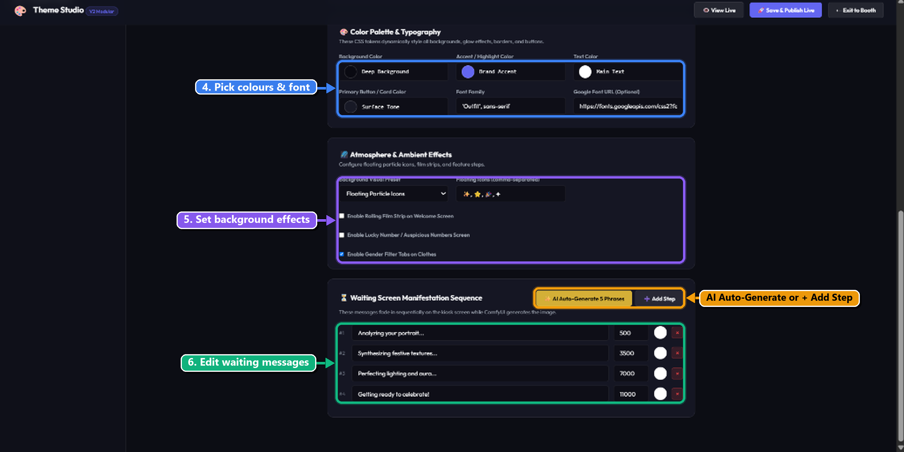
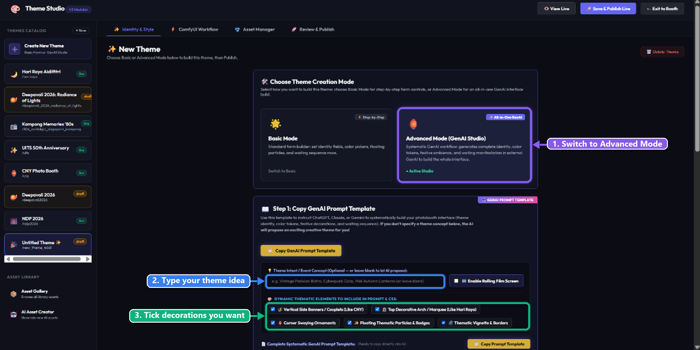
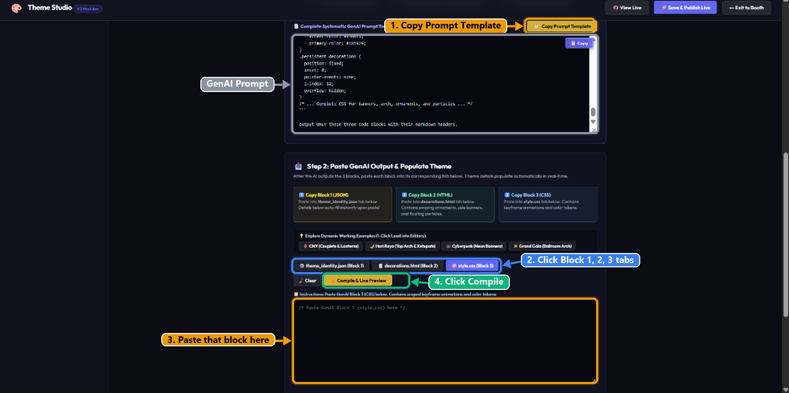
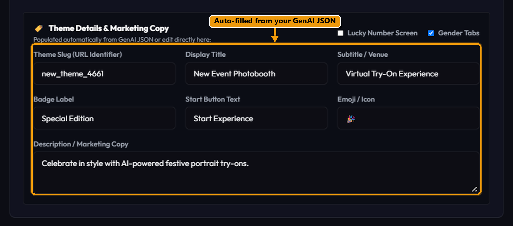

# SEIT Vision Studio: How to Build a New Theme (Step-by-Step Guide)

A beginner-friendly, illustrated walkthrough on creating, styling, compiling, and publishing a brand-new photobooth theme in **SEIT Vision Studio**.

---

## Tutorial Overview & Mode Comparison

When creating a new theme, SEIT Vision Studio offers two distinct workflows:

| Feature / Mode | 🛠️ Basic Mode (Form Builder) | 🤖 Advanced Mode (GenAI Studio) |
| :--- | :--- | :--- |
| **Workflow Style** | Step-by-step manual form controls | 1-prompt generative AI pipeline |
| **Best For** | Exact manual tweaks, custom color hex codes, specific typography | Fast automated theme creation with full festive decorations |
| **Inputs Required** | Slug, Title, Subtitle, Hex Colors, Particle Emojis, Waiting Phrases | Single prompt into ChatGPT/Claude/Gemini, paste 3 code blocks |
| **Aesthetic Output** | Clean standard UI layout | Rich SVG corner ornaments, side couplets, floating badges, and CSS animations |

---

## Step 1: Enter Theme Studio from the Landing Page

1. From the SEIT Vision Studio main landing page, locate the top navigation header.
2. Click on **Theme Studio** in the top navigation bar.

---

## Step 2: Click "Create New Theme" & Choose Your Mode

1. In the left-hand **THEMES CATALOG** sidebar, click the **`+ Create New Theme`** card (or the **`+ New`** button at the top).
2. A new draft titled **`Untitled Theme`** will appear in the catalog.
3. In the main builder window, you will see the **Choose Theme Creation Mode** selector:
   - **Basic Mode:** Select for manual field inputs.
   - **Advanced Mode (GenAI Studio):** Select to use the AI prompt and code block generator.

---

## Step 3: Basic Mode (Form Builder Controls)

If you choose **Basic Mode**, complete the four structured form cards:

1. **Basic Identity:**
   - **Theme Slug (URL Identifier):** e.g., `new_theme_4661` or `deepavali_2026`.
   - **Display Title:** The main title shown to booth visitors.
   - **Subtitle / Venue:** Explanatory text (e.g. *Virtual Try-On Experience*).
   - **Badge Label:** E.g. *Special Edition*.
   - **Emoji / Icon:** E.g. 🪔 or 🎉.
   - **Start Button Text:** E.g. *Start Experience*.
   - **Description / Sub-header:** Marketing copy introducing the celebration.

2. **Color Palette & Typography:**
   - Pick color tokens for **Deep Background**, **Brand Accent**, **Main Text**, and **Primary Button / Surface Tone**.
   - Set the font family (e.g., `'Outfit', sans-serif`) and an optional Google Font URL.

3. **Atmosphere & Ambient Effects:**
   - Choose a preset (e.g. **Floating Particle Icons**) and list comma-separated emojis (e.g. `✨, ⭐, 🎉, ✦`).
   - Toggle optional feature screens: *Rolling Film Strip*, *Lucky Number Screen*, or *Gender Filter Tabs*.

4. **Waiting Screen Manifestation Sequence:**
   - These messages fade in sequentially while ComfyUI generates the portrait.
   - Set each phrase and delay in milliseconds (e.g. `500`, `3500`, `7000`, `11000`).
   - Click **`✨ AI Auto-Generate 5 Phrases`** or **`+ Add Step`** to quickly build the sequence.

---

## Step 4: Advanced Mode — Set Theme Intent & Decorative Elements

If you select **Advanced Mode (GenAI Studio)**:

1. **Switch to Advanced Mode:** Click the **`Advanced Mode (GenAI Studio)`** card.
2. **Theme Intent / Event Concept:** Enter your theme concept (e.g. *Deepavali 2026 Festival of Lights*, *Vintage Parisian Bistro*, or *Cyberpunk Neon Gala*).
3. **Dynamic Thematic Elements:** Check the boxes for the elements you want included in your prompt:
   - *Vertical Side Banners / Couplets*
   - *Top Decorative Arch / Marquee*
   - *Corner Swaying Ornaments*
   - *Floating Thematic Particles & Badges*
   - *Thematic Vignette & Borders*

---

## Step 5: Copy Prompt Template, Paste into ChatGPT & Paste the 3 Code Blocks

1. Click the gold **`Copy Prompt Template`** button above the prompt viewer.
2. Paste the prompt into your chosen GenAI tool (ChatGPT, Claude, or Gemini). The AI will return **3 structured blocks**.
3. In SEIT Vision Studio under **Step 2: Paste GenAI Output & Populate Theme**, switch between the 3 editor tabs:
   - **`theme_identity.json (Block 1)`**: Paste the JSON payload here.
   - **`decorations.html (Block 2)`**: Paste the HTML decorations markup here.
   - **`style.css (Block 3)`**: Paste the scoped CSS rules and animations here.
4. Click **`✨ Compile & Live Preview`** to compile the theme.

---

## Step 6: Review Auto-Filled Copy, Test "View Live" & Publish

1. Scroll down to verify that **Theme Details & Marketing Copy** has auto-filled from Block 1.
2. In the top navigation bar, click **`👁️ View Live`** to preview the full interface, test button interactions, and inspect decorations.
3. Once satisfied, click **`🚀 Save & Publish Live`** in the top navigation header to make the theme active for booth visitors!

---

## Quick Reference Checklist

- [x] Started from Landing Page & entered Theme Studio
- [x] Created New Theme draft (`Untitled Theme`)
- [x] Chose Basic Mode (manual forms) or Advanced Mode (GenAI 3-block pipeline)
- [x] Pasted Block 1 (`theme_identity.json`), Block 2 (`decorations.html`), and Block 3 (`style.css`)
- [x] Clicked `Compile & Live Preview`
- [x] Checked interactive layout via `View Live`
- [x] Clicked `Save & Publish Live`
