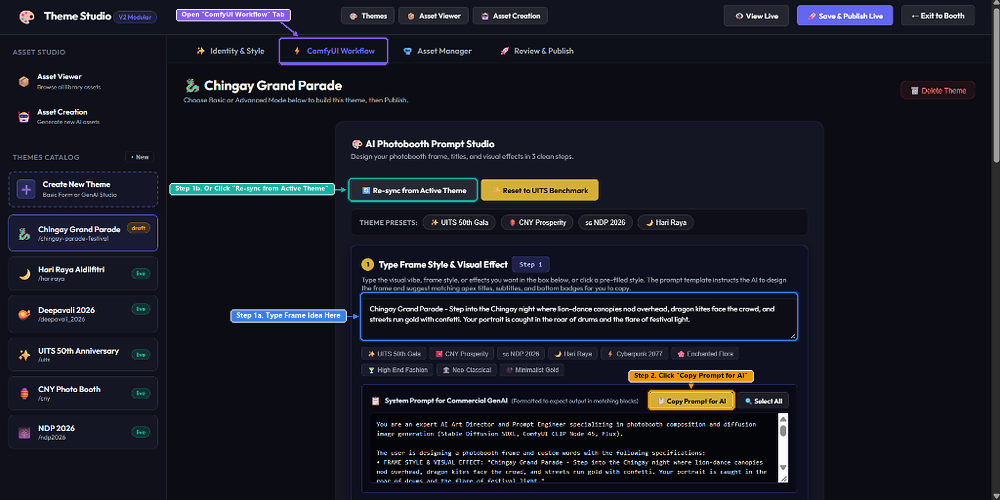
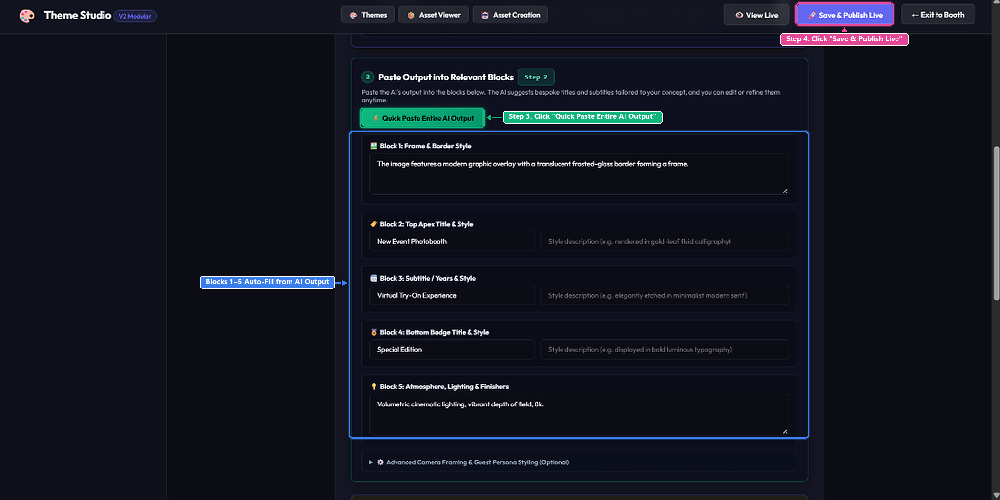

# Easy Guide: ComfyUI Workflow (AI Photobooth Prompt Studio)

A quick, step-by-step guide on how to design and publish custom photo booth frames, titles, and visual effects in the **ComfyUI Workflow** tab.

---

## Step 1 & Step 2: Set Your Frame Idea & Copy the AI Prompt

First, open the **⚡ ComfyUI Workflow** tab at the top of Theme Studio.

### Step 1: Describe Your Frame (or Re-sync from Theme)
- **Have an idea?** Type how you want your photo booth frame and visual effects to look inside the **Type Frame Style & Visual Effect** box (or click any of the quick style tags below it).
- **Don't have an idea?** Simply click the **🔄 Re-sync from Active Theme** button! It will automatically pull the concept and style from the theme you already created.

### Step 2: Copy the Prompt for AI
- Click the **📋 Copy Prompt for AI** button.
- Open any generative AI model of your choice (such as ChatGPT, Claude, Gemini, or DeepSeek), paste the prompt in, and send it.

---

## Step 3 & Step 4: Quick Paste AI Response & Publish Live

Scroll down to **Step 2: Paste Output into Relevant Blocks** inside the ComfyUI Workflow tab.

### Step 3: Quick Paste the AI Response
- Copy the full response that your generative AI gave you.
- Click the green **⚡ Quick Paste Entire AI Output** button and paste the response in.
- All 5 blocks (**Frame & Border Style**, **Top Apex Title**, **Subtitle**, **Bottom Badge**, and **Atmosphere & Lighting**) will automatically fill themselves in!

### Step 4: Save & Publish Live
- Review the auto-filled blocks (you can edit any text if you wish).
- Finally, click the purple **🚀 Save & Publish Live** button at the top right to save and apply your new photo booth frame live!
