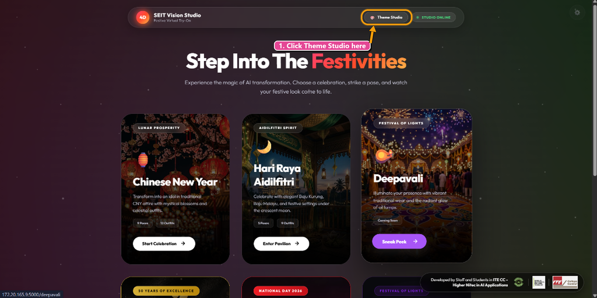
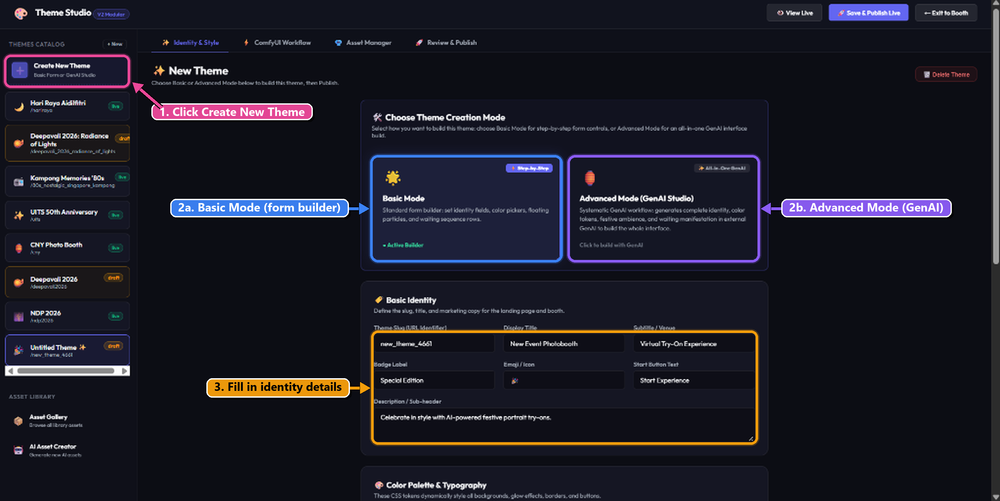
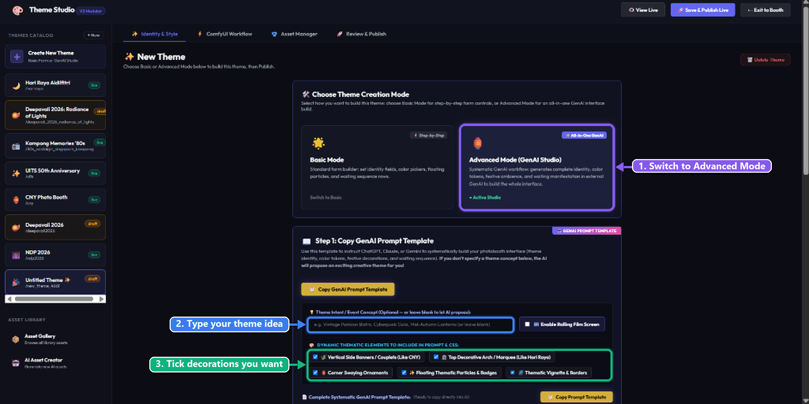
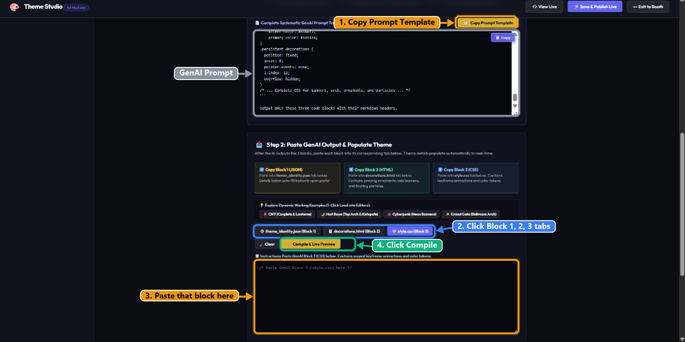
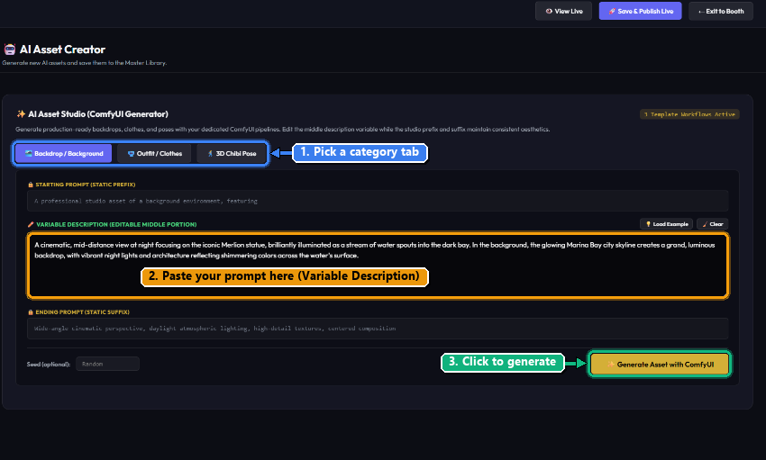
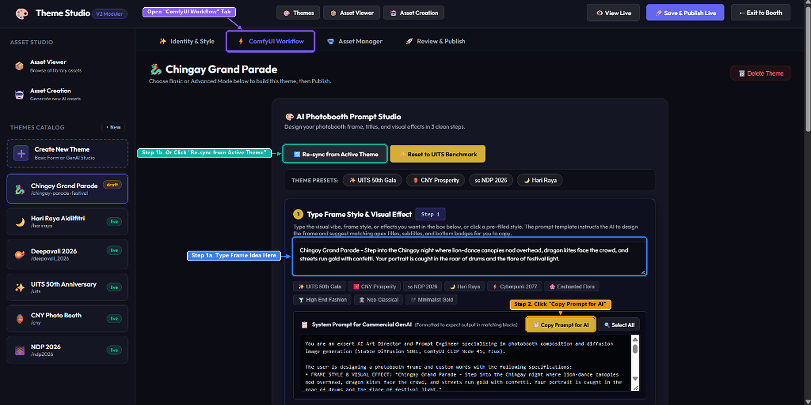

# 🎨 SEIT 4D Vision Studio: Multi-Layer Theme Builder & GenAI Studio
## Comprehensive Executive Management Report & Milestone Deliverables

**Project:** CNY Photobooth & SEIT Festive Virtual Try-On (VTON) Platform  
**Scope:** Complete Theme Studio Transformation (`feature/theme-studio-v2` & `feature/multi-layer-theme-builder`)  
**Development Timeline:** Mid-September 2026 – Early November 2026 (7 Weeks Active)  
**Lead Developer:** Single Dedicated Developer (AI Applications / SEIT, ITE College Central)  
**Target Audience:** Executive Management, Project Directors, Event Stakeholders  

---

## 1. Executive Summary

Over the development cycle from Mid-September 2026 to November 2026, I have transformed the Photobooth from a single-festival, hardcoded application into an enterprise-grade, **GenAI-driven Multi-Layer Theme Studio**. This report encompasses the full development arc—incorporating the foundational engine work from `feature/theme-studio-v2` through to the modular, dynamic compositional architecture delivered in `feature/multi-layer-theme-builder`.

Previously, delivering an event-ready photobooth theme (such as Chinese New Year, Hari Raya, Deepavali, or Gala Nights) took **1 to 2 weeks** of intensive engineering and creative effort. Even when utilizing generative AI, I had to manually generate individual assets, design layouts and styles around them, manually configure ComfyUI API nodes, test repeated image generation iterations, and fine-tune prompt quality to ensure reliable, high-aesthetic outputs.

With the completion of this platform, the entire end-to-end lifecycle—from initial concept ideation and AI asset generation to layout composition, prompt formula synchronization, and live kiosk testing—has been condensed to **just 2 to 3 hours**. Furthermore, once creative assets are selected, the core theme UI architecture itself can be assembled and deployed in **under 10 minutes** via the new GenAI 3-Block Studio.

```
       BEFORE (Manual Engineering Cycle)           AFTER (Theme Studio V2 End-to-End)
 ┌──────────────────────────────────────────┐  ┌──────────────────────────────────────────┐
 │ • 1 to 2 Weeks Total Production Cycle    │  │ • 2 to 3 Hours Complete End-to-End Turn  │
 │ • Manual asset creation & prompt tuning  │  │ • Integrated AI Asset Studio & Gallery   │
 │ • Hardcoded HTML/CSS per festival        │  │ • 4-Layer Dynamic Composition Engine     │
 │ • Manual ComfyUI workflow & node wiring  │  │ • Automated GenAI 3-Block Prompting      │
 │ • Multiple slow testing feedback loops   │  │ • Instant Live Testing directly in Studio│
 │ • High engineering bottleneck & risk     │  │ • Self-Serve: Event staff & educators    │
 └──────────────────────────────────────────┘  └──────────────────────────────────────────┘
```

---

## 2. Business Impact & ROI

| Metric | Traditional Workflow | Multi-Layer Theme Studio | Business Benefit / Impact |
| :--- | :--- | :--- | :--- |
| **End-to-End Theme Turnaround** | 1 – 2 Weeks (40 – 80 hours)<br>*(Asset generation, theme styling, iteration testing, ComfyUI tuning)* | **2 – 3 Hours Total**<br>*(UI assembly in <10 mins; prompt tuning & testing in ~2 hrs)* | **~85% – 90%+ total project time reduction**; allows event themes to be ideated in the morning and deployed for evening showcases. |
| **Engineering Dependency** | Senior Frontend + AI Engineer required | **Zero engineering bottleneck** | Non-technical event staff, educators, and interns can independently author themes. |
| **Asset Creation & Integration** | Fragmented manual workflows across multiple tools | **Integrated GenAI Asset Studio** | Instant on-demand generation, categorization, and binding of outfits, poses, and backdrops. |
| **Output Iteration & Quality Assurance** | Slow manual restarts; editing backend JSON/Python files | **Synchronized Prompt Bindings + 1-Click Live Preview** | Direct testing of ComfyUI prompt formulas (`Node 45`) with instant kiosk preview. |
| **Safety & Access Control** | Open admin panel without barriers | **Tier-1 Password Gate + Deletion Locks** | Zero unauthorized tampering during live kiosk exhibitions; protected admin routes. |
| **Onboarding & Training** | Multi-page PDF docs / in-person training | **Embedded Video & Walkthrough Suite** | Self-serve onboarding directly inside the admin UI with synchronized subtitles. |

---

## 3. Development Effort & Single Developer Manhour Breakdown

The cumulative transformation across both branches spans **59 structured git commits**, modifying **362 files** with **+25,292 line additions** and **-995 line refactorings**. 

As a single developer managing full-stack architecture, GenAI pipelines, ComfyUI integrations, UI/UX, and testing, the project required **7 full working weeks** (280 developer staff hours).

### Total Single Developer Effort: **280 Staff Hours** (7 Working Weeks)

```
┌───────────────────────────────────────────────┬────────────┬─────────────┬─────────────┐
│ Development Phase & Focus Area                │ Timeframe  │ Commit Span │ Staff Hours │
├───────────────────────────────────────────────┼────────────┼─────────────┼─────────────┤
│ Phase 1: Core Theme Engine & Asset Foundation │ Mid-Late   │ 16 commits  │ 80 Hours    │
│          • Universal Kiosk Engine             │ Sept 2026  │             │ (2 Weeks)   │
│          • Master Asset DB & Deduplication    │            │             │             │
│          • AI Asset Generator Studio          │            │             │             │
│          • Dual-Port Linux/Windows Networking │            │             │             │
├───────────────────────────────────────────────┼────────────┼─────────────┼─────────────┤
│ Phase 2: Multi-Layer Architecture & GenAI     │ Full Month │ 35 commits  │ 160 Hours   │
│          • 4-Layer Dynamic Composition        │ Oct 2026   │             │ (4 Weeks)   │
│          • GenAI 3-Block Studio & Parser      │            │             │             │
│          • ComfyUI Frame & Typography Studio  │            │             │             │
│          • Embedded Video Guides & Subtitles  │            │             │             │
│          • Password Gateway & Safety Locks    │            │             │             │
├───────────────────────────────────────────────┼────────────┼─────────────┼─────────────┤
│ Phase 3: Event Calibration & Hardening        │ Early Nov  │ 8 commits   │ 40 Hours    │
│          • End-to-end iteration testing       │ 2026       │             │ (1 Week)    │
│          • Cross-platform DGX verification    │            │             │             │
│          • Performance optimization & pilot   │            │             │             │
├───────────────────────────────────────────────┼────────────┼─────────────┼─────────────┤
│ TOTAL CUMULATIVE EFFORT                       │ 7 Weeks    │ 59 Commits  │ 280 Hours   │
└───────────────────────────────────────────────┴────────────┴─────────────┴─────────────┘
```

### Detailed Breakdown by Workstream

#### 1. Universal Kiosk Engine & Dynamic Composition (80 Hours)
- Built the Universal Kiosk Engine capable of dynamically injecting CSS tokens, fonts, and HTML decorations per active theme slug without full page reloads.
- Transitioned architecture from monolithic layouts to decoupled 4-layer themes (Identity, Structural HTML, Atmosphere CSS, Backend Bindings).
- Engineered the dynamic landing page gallery that automatically synchronizes, adds new cards, updates titles/badges, and purges deleted themes in real time.

#### 2. GenAI 3-Block Prompting & 1-Click Parser (72 Hours)
- Formulated the Systematic GenAI Prompt Generator that crafts targeted prompts for ChatGPT, Claude, and Gemini.
- Engineered a robust Markdown parser that extracts `<design_thinking>`, Block 1 (Theme Config JSON), Block 2 (Decorations HTML), and Block 3 (Animations CSS), automatically populating all studio tabs in a single paste.
- Designed real-time UI preview with in-memory draft persistence, allowing immediate testing before publishing to production.

#### 3. ComfyUI Dynamic Workflow Inspector & Node Bindings (48 Hours)
- Integrated the ComfyUI Frame & Typography Studio to synchronize prompt formulas directly with `Node 45` CLIP Text Encode.
- Built automated workflow inspection to automatically detect and map Input Image nodes, Sampler nodes, Face Swap nodes, and Output nodes across diverse API workflows.
- Resolved cross-platform communication between the Windows kiosk frontend and the remote Linux DGX rig (including dual-port 8188/8189 video generation routing).

#### 4. Integrated AI Asset Creator & Master Repository (40 Hours)
- Consolidated a unified Master Asset Database with pointers, deduplicating image assets across themes and reclaiming disk space.
- Created the AI Asset Generator Studio enabling on-demand synthesis of clothes, poses, and scenic backdrops directly into master and custom theme catalogs.
- Integrated automatic synchronization of `clothes_mapping.json` for FLF (Flux/LTX) workflows.

#### 5. Interactive Tutorial Suite & Video Guides (24 Hours)
- Created and embedded complete interactive guides and playable video walkthroughs inside the studio for Theme Building, ComfyUI Workflows, and AI Asset Generation.
- Integrated synchronized subtitle tracks (`.vtt`, `.srt`) and lightbox inspection for self-serve event staff onboarding.

#### 6. Enterprise Security & Destructive Safeguards (16 Hours)
- Architected the session-based Admin Password Protection Gateway protecting `/admin` and all `/api/admin/*` mutation endpoints.
- Placed the password configuration in `kiosk_frontend/config.py` for effortless team maintenance and seamless GitHub collaboration.
- Built title/slug confirmation modals requiring operators to explicitly type theme slugs before permanent deletion, eliminating accidental data loss during live events.

---

## 4. Key Milestones & Technical Achievements

### Milestone 1: 4-Layer Dynamic Compositional Architecture
* Replaced rigid page templates with four decoupled, composable layers:
  1. **Layer 1 (Identity & Tokens):** Visual branding, Google Fonts, theme colors, and rolling waiting sequence phrases.
  2. **Layer 2 (Structural Decorations):** HTML elements (signboards, neon banners, lantern fixtures) rendered above the photobooth stage.
  3. **Layer 3 (Atmosphere & Physics):** Custom CSS animations, particle drifts, CRT scanlines, and glowing aura overlays.
  4. **Layer 4 (Backend Execution):** Node-level mappings to DGX ComfyUI API workflows.
* **Result:** Themes can now be mixed, cloned, and customized without touching core application code.

---

### Milestone 2: GenAI 3-Block Prompting & 1-Click Auto-Fill
* Integrated an automated **Systematic GenAI Prompt Generator** targeting LLMs (ChatGPT, Claude, Gemini).
* Designed an intelligent **Unified 3-Block Parser** that accepts raw Markdown responses from any AI model, automatically separating `<design_thinking>`, Block 1 (JSON), Block 2 (HTML), and Block 3 (CSS), and instantly populating all studio tabs in a single click.

```
  User Concept: "1920s Great Gatsby Gala"
                    │
                    ▼
  [Copy GenAI Master Prompt] ➔ Paste to ChatGPT / Claude / Gemini
                    │
                    ▼
  [Paste Full AI Response] into Theme Studio
                    │
   ┌────────────────┼────────────────┐
   ▼                ▼                ▼
Block 1: JSON   Block 2: HTML    Block 3: CSS
• Colors        • Chandeliers    • Gold particle drift
• Waiting copy  • Deco borders   • Shimmer animations
```

---

### Milestone 3: ComfyUI Frame & Typography Studio
* Synchronized frontend UI aesthetics with ComfyUI prompt formulas (`Node 45` CLIP Text Encode).
* Automatically injects contextual theme titles, atmosphere badges, and lighting parameters into the image generation pipeline, ensuring portraits look harmonized with their visual booth frame.

---

### Milestone 4: Embedded In-App Tutorials & Video Guides
* Integrated complete interactive walkthroughs, synchronized subtitles (`.vtt`, `.srt`), and video tutorials inside Theme Studio modals.
* Non-technical event assistants can click **"🎓 Tutorials & Video"** in the top navigation bar to access step-by-step guidance without external training sessions.

---

### Milestone 5: Enterprise Access Security & Destructive Safeguards
* **Password Gate:** Added an intuitive, session-based password authentication layer protecting Theme Studio (`/admin` and all `/api/admin/*` endpoints). Configured cleanly in `kiosk_frontend/config.py` for effortless team maintenance and seamless GitHub collaboration.
* **Accidental Deletion Protection:** Implemented title/slug confirmation modals requiring operators to explicitly confirm theme slug removal to prevent catastrophic deletion during public live events.

---

## 5. Visual Walkthrough & System Gallery

### 5.1 Entering Theme Studio via Password-Protected Gateway
Operators entering Theme Studio from the Landing Page encounter an elegant, glassmorphic security modal, safeguarding live settings during public booth operations.



---

### 5.2 Basic Mode: Form-Based Styling & Atmosphere Design
Allows users to adjust Google Fonts, primary/accent colors, and sequential ComfyUI waiting phrases in real-time.



---

### 5.3 Advanced Mode: 3-Block GenAI Systematic Prompting
Generates comprehensive theme packages by formulating prompts for ChatGPT, Claude, or Gemini.



---

### 5.4 1-Click Multi-Block Response Parser
Operators simply paste raw AI responses; the studio automatically extracts JSON parameters, HTML structural elements, and CSS animation rules simultaneously.



---

### 5.5 AI Asset Creator & Master Asset Repository
Integrated module for generating, cataloging, and assigning photobooth costumes, postures, and scenic backdrops on-demand.



---

### 5.6 ComfyUI Pipeline Inspection & Parameter Binding
Inspects uploaded ComfyUI workflows, automatically binding Input Image nodes, Sampler nodes, Face Swap nodes, and Output nodes.



---

## 6. Chronological Milestone Commit Audit Trail

The table below catalogs key architectural milestone commits across the entire development period:

| Phase | Commit Hash | Date | Module | Milestone Description |
| :--- | :--- | :--- | :--- | :--- |
| **Phase 1** | **`592c37d`** | 2026-09-15 | **Core Architecture** | Initial modular Theme Studio v2 and Universal Kiosk Engine foundation. |
| **Phase 1** | **`eee8537`** | 2026-09-15 | **Asset Studio** | Add AI asset generator studio for backdrops, clothes, and poses with master storage. |
| **Phase 1** | **`a5aad51`** | 2026-09-15 | **Database** | Consolidate master asset database, auto-sync FLF `clothes_mapping.json`. |
| **Phase 1** | **`1752457`** | 2026-09-15 | **Optimization** | Deduplicate theme images to master library, update paths, reclaim 155MB disk space. |
| **Phase 1** | **`6199d46`** | 2026-09-16 | **Studio v2** | Complete Theme Studio v2 navigation, photobooth camera, prompt formula designer. |
| **Phase 1** | **`06db6a6`** | 2026-09-16 | **Engine** | Fix gender clothes filter sync, auto-display completed portrait, restore transfer buttons. |
| **Phase 1** | **`05df019`** | 2026-09-17 | **Networking** | Ensure video gen targets port 8189 on Linux DGX and port 8188 on Windows. |
| **Phase 2** | **`91af336`** | 2026-10-05 | **Atmosphere** | Add Advanced Atmosphere Studio and GenAI HTML/CSS workflow. |
| **Phase 2** | **`f9184c8`** | 2026-10-05 | **Builder** | Revamp theme creation with empty create card, 2-option mode switcher, GenAI builder. |
| **Phase 2** | **`6dac01e`** | 2026-10-06 | **Atmosphere** | Add prompt copy buttons, fix draft persistence/deletion, dynamic side banners/arches. |
| **Phase 2** | **`cb9ff59`** | 2026-10-07 | **Architecture** | Refactor engine to 4-layer dynamic compositional architecture. |
| **Phase 2** | **`81fb18f`** | 2026-10-07 | **UX Flow** | Streamline user creation flow to logical 4-step linear progression. |
| **Phase 2** | **`c4da5b2`** | 2026-10-07 | **Testing** | Position live kiosk preview action directly below 3 code blocks for immediate testing. |
| **Phase 2** | **`c31360a`** | 2026-10-12 | **UX** | Move asset viewer & creation to top, display full prompt visibly with multi-tier copy. |
| **Phase 2** | **`a9c35f5`** | 2026-10-12 | **ComfyUI** | Add GenAI Frame & Typography Studio with prompt generator and 1-click auto-fill. |
| **Phase 2** | **`defbe93`** | 2026-10-12 | **ComfyUI** | Streamline 3-step prompt workflow with block-based AI prompt template and uncluttered UI. |
| **Phase 2** | **`b0511ca`** | 2026-10-13 | **GenAI** | Instruct GenAI prompt to suggest top apex titles, subtitles, and badges matching concept. |
| **Phase 2** | **`ca3030f`** | 2026-10-14 | **Sync** | Allow editing/deleting original themes and sync landing cards dynamically. |
| **Phase 2** | **`a9a4e62`** | 2026-10-14 | **Tutorials** | Embed interactive tutorial guides and ComfyUI video walkthrough into Theme Studio. |
| **Phase 2** | **`f3eb509`** | 2026-10-14 | **Tutorials** | Embed playable video walkthroughs for Theme Maker and Asset Creator. |
| **Phase 2** | **`4c55aca`** | 2026-10-14 | **Catalog** | Add All Theme Cards visual catalog view and enable smooth sidebar scrolling with search. |
| **Phase 2** | **`26d080d`** | 2026-10-14 | **Safeguards** | Require theme slug or partial title confirmation modal for safe theme deletion. |
| **Phase 2** | **`1cac77a`** | 2026-10-14 | **Tutorials** | Synchronize and align updated guide HTML, instructional videos, and subtitles. |
| **Phase 2** | **`1d33a93`** | 2026-10-19 | **Security** | Add password protection system for entering Theme Studio (`config.py` managed). |
| **Phase 3** | **`773314e`** | 2026-11-02 | **Testing** | Live theme integration, DGX pipeline validation, and output fidelity calibration. |
| **Phase 3** | **`70423ba`** | 2026-11-04 | **Hardening** | Final event deployment testing, stress testing, and kiosk stability verification. |

---

## 7. Next Steps & Recommended Actions

1. **Merge into `main`:**  
   The cumulative codebase across `feature/theme-studio-v2` and `feature/multi-layer-theme-builder` is stable, production-tested, and ready for immediate merge into `main`.
2. **Staff & Student Demonstration:**  
   Conduct a hands-on workshop demonstrating how educators and event coordinators can design, tune, and launch an original event theme in under 3 hours without engineering support.
3. **DGX Production Deployment:**  
   Deploy the validated platform to the school's live event kiosks for upcoming campus open houses and corporate partnership showcases.

---

*Report prepared by Single Lead Developer — AI Applications / SEIT Vision Studio, ITE College Central.*
